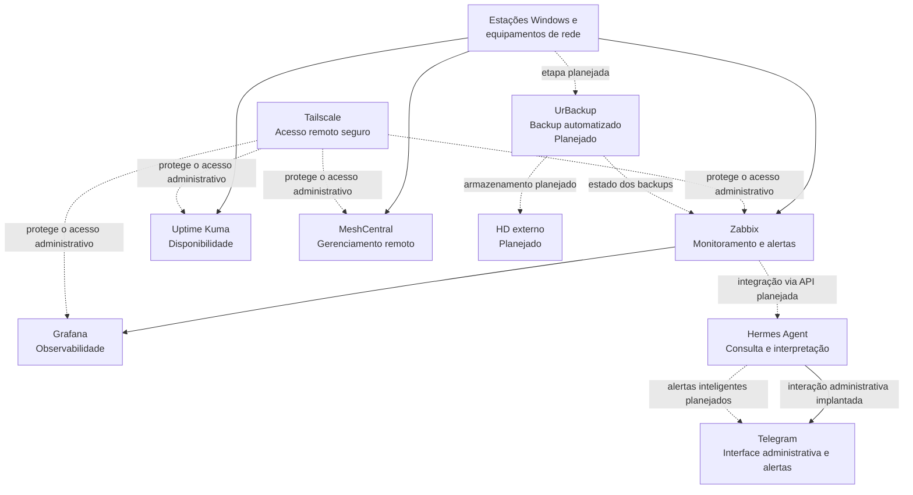
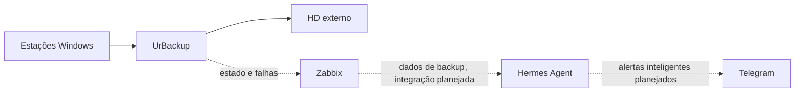

# NEPEAC Infrastructure Monitoring

> Plataforma open-source para monitoramento, observabilidade, gerenciamento remoto e automação da infraestrutura do NEPEAC.

## Sobre o projeto

Este repositório documenta a implantação de uma plataforma centralizada para acompanhar servidores, estações Windows, equipamentos de rede e serviços críticos. A solução prioriza ferramentas open-source, acesso remoto protegido e documentação reproduzível.

A base de monitoramento e gerenciamento está implantada. A integração completa entre a API do Zabbix e o Hermes Agent permanece planejada. O backup centralizado das estações Windows também permanece em planejamento.

O repositório contém apenas documentação e exemplos sanitizados. Ele não armazena credenciais, endereços internos, bancos de dados, sessões, logs operacionais ou configurações de produção.

## Arquitetura



O Zabbix concentra métricas e eventos. O Grafana organiza a visualização. O Hermes Agent deverá consultar a API do Zabbix antes de interpretar o estado do ambiente. O Telegram funciona como interface administrativa e canal planejado para alertas inteligentes.

O Uptime Kuma executa verificações de disponibilidade. O MeshCentral centraliza o acesso remoto autorizado. O Tailscale protege as interfaces administrativas sem exposição pública direta.

## Tecnologias

| Tecnologia | Função no projeto | Estado |
| --- | --- | --- |
| Ubuntu Server 22.04 LTS | Sistema operacional do servidor central | Implantado |
| Zabbix | Coleta de métricas, monitoramento de hosts, eventos e alertas | Implantado |
| Grafana | Dashboards e visualização dos dados de monitoramento | Implantado |
| Uptime Kuma | Verificações de disponibilidade, latência e serviços | Implantado |
| MeshCentral | Gerenciamento remoto autorizado das estações | Implantado |
| Tailscale | Rede privada para acesso administrativo | Implantado |
| Hermes Agent | Camada inteligente de consulta, análise e interpretação | Base implantada |
| Telegram | Interface entre o administrador e o Hermes Agent | Implantado |
| UrBackup | Backup centralizado das estações Windows | Planejado |

## Monitoramento

### Base implantada

A base atual inclui o agente Zabbix no servidor, o servidor de monitoramento, a visualização pelo Grafana, o mecanismo de verificações do Uptime Kuma e o gerenciamento remoto pelo MeshCentral. Cada novo host ou equipamento deve passar por cadastro e validação antes de ser considerado monitorado.

### Cobertura planejada

A evolução da plataforma deverá acompanhar:

- disponibilidade dos hosts
- estado do servidor central
- utilização de CPU
- utilização de memória RAM
- capacidade e uso do armazenamento
- disponibilidade de serviços HTTP e TCP
- latência e perda de pacotes
- disponibilidade do gateway
- equipamentos de rede compatíveis
- estações Windows
- estado e validade dos backups, após a implantação do UrBackup

Métricas detalhadas de Wi-Fi dependem de suporte a Simple Network Management Protocol (SNMP), controlador ou interface de programação de aplicações (API) no equipamento de rede.

## Hermes Agent

A arquitetura separa coleta, visualização e interpretação:

1. **Zabbix** registra métricas, eventos e problemas.
2. **Grafana** apresenta dashboards baseados nos dados disponíveis.
3. **Hermes Agent** consulta fontes autorizadas e interpreta o resultado.
4. **Telegram** entrega consultas e alertas ao administrador.

O Hermes Agent deve consultar dados reais antes de responder perguntas sobre o ambiente. Ele não deve inferir disponibilidade, incidentes ou backups sem evidência atual das fontes de monitoramento.

Exemplos de consultas previstas:

- “Como está a rede?”
- “Existem máquinas offline?”
- “Qual é o estado do servidor?”
- “Quais problemas estão ativos?”
- “Quando foi o último backup do PC identificado no inventário?”

A integração completa entre a API do Zabbix e o Hermes Agent permanece no roadmap.

## Backup automatizado: planejado

A arquitetura planejada usa o UrBackup para centralizar cópias das estações Windows em um HD externo:



Objetivos da etapa:

- backup automático
- cópias incrementais
- versionamento
- restauração de arquivos e sistemas
- política de retenção
- monitoramento do UrBackup pelo Zabbix
- alertas pelo Hermes Agent e Telegram
- testes automatizados de restauração

Esta seção descreve uma arquitetura planejada. O UrBackup e o HD externo ainda não integram o ambiente de produção.

## Hardware atual

O servidor utiliza hardware reaproveitado e adequado à etapa inicial do projeto:

| Componente | Especificação |
| --- | --- |
| Processador | Intel Core 2 Duo E4600, 2 núcleos, 2,40 GHz |
| Placa-mãe | Intel DG31PR |
| Memória RAM | 2 GB instalados, com expansão planejada para 4 GB |
| Armazenamento interno | WD Blue 500 GB |
| Armazenamento de backup | HD externo planejado |

Números de série, identificadores de hardware e endereços de rede não fazem parte da documentação pública.

## Estrutura do repositório

```text
.
├── backup/
├── docs/
├── examples/
├── grafana/
├── hermes/
├── meshcentral/
├── scripts/
├── uptime-kuma/
├── zabbix/
├── .gitignore
├── README.md
└── SECURITY.md
```

Cada diretório contém documentação sanitizada sobre seu componente. Arquivos operacionais somente serão adicionados após revisão individual.

## Segurança da publicação

Este projeto segue uma política de publicação mínima:

- não copiar diretórios de produção
- não publicar arquivos `.env`
- não publicar senhas, tokens, cookies, sessões ou chaves
- não publicar IPs internos, identificadores únicos ou dados pessoais
- não publicar bancos, dumps, backups ou logs
- não publicar configurações com credenciais embutidas
- usar placeholders reconhecíveis em qualquer exemplo futuro
- revisar individualmente cada arquivo antes do commit
- executar varredura de segredos antes de qualquer push

Consulte [`SECURITY.md`](SECURITY.md) para conhecer as regras de contribuição e relato de vulnerabilidades.

## Roadmap

- [x] Ubuntu Server 22.04 LTS
- [x] Zabbix
- [x] Grafana
- [x] Uptime Kuma
- [x] MeshCentral
- [x] Tailscale
- [x] Hermes Agent instalado
- [x] Telegram como interface administrativa
- [ ] Upgrade para 4 GB de RAM
- [ ] Implantar backup centralizado com UrBackup
- [ ] HD externo dedicado aos backups
- [ ] Monitoramento dos backups pelo Zabbix
- [ ] Integração completa entre Zabbix API e Hermes Agent
- [ ] Alertas inteligentes pelo Telegram
- [ ] Testes automatizados de restauração

## Licença

Este projeto usa a **Apache License 2.0**. A licença permite uso, modificação e redistribuição, além de incluir uma concessão explícita de patentes. Consulte [`LICENSE`](LICENSE) para ler os termos completos.

## Status

O repositório está em preparação e ainda não foi publicado. A documentação será atualizada conforme o ambiente evoluir e cada etapa for validada.
