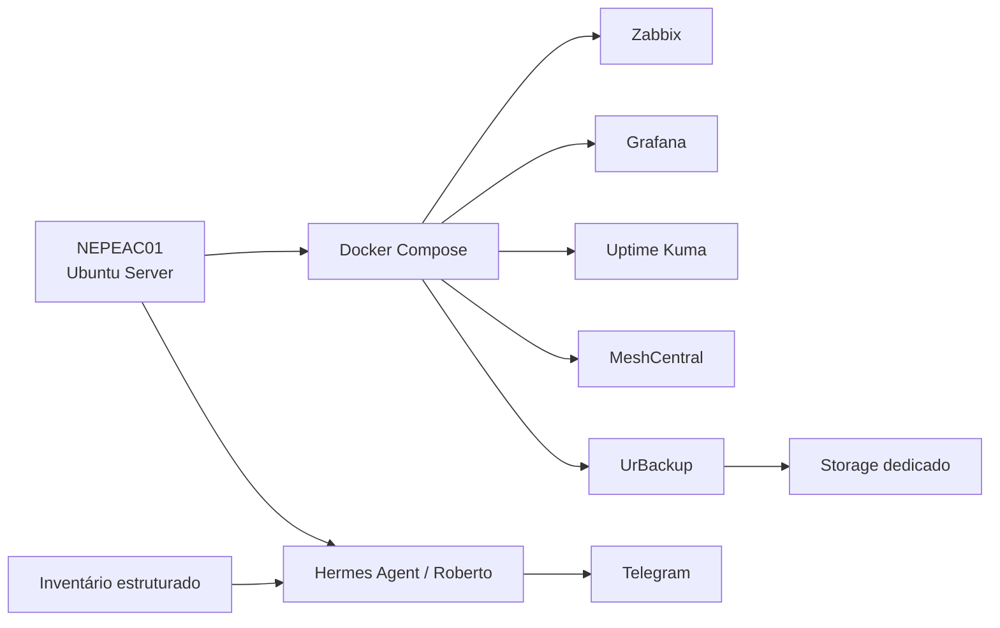

# Arquitetura

A arquitetura combina serviços locais em Docker Compose, acesso administrativo privado por VPN mesh, inventário estruturado e relatórios operacionais automatizados.

## Princípios

- simplicidade operacional;
- baixo consumo de recursos;
- separação entre documentação pública e dados privados;
- monitoramento baseado em fontes determinísticas;
- backup com validação por restauração, não apenas por job concluído;
- mudanças graduais com rollback documentado.

## Componentes

## Fronteiras

- Serviços administrativos são pensados para acesso privado, não exposição pública direta.
- Segredos ficam fora do repositório.
- O inventário público é demonstrativo; o inventário real permanece privado.
